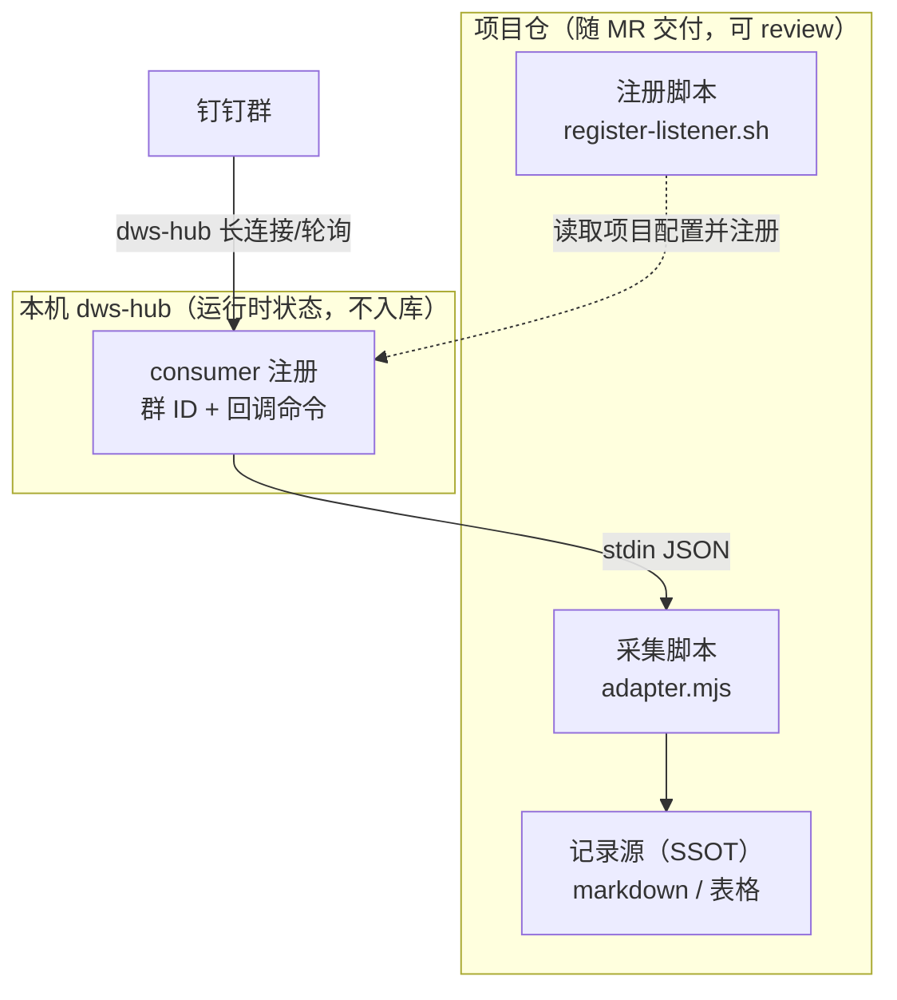
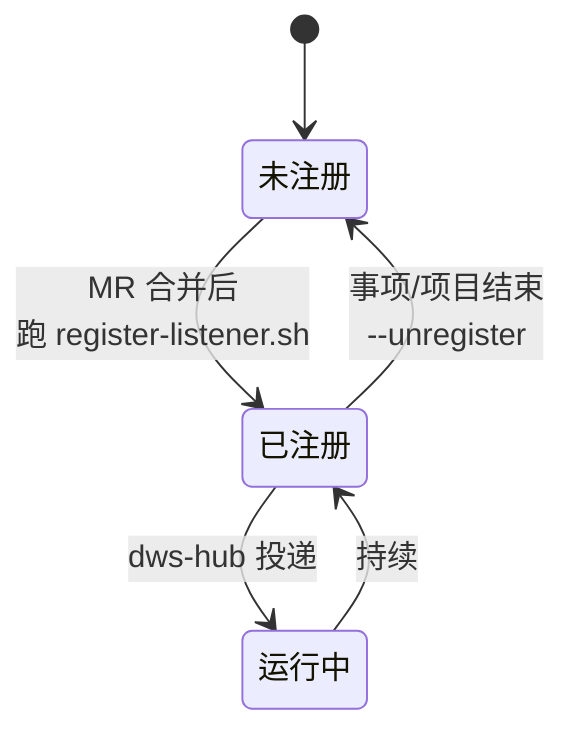

# 实践范例：项目级事项监听（project-scope observer）

> **TL;DR**：项目里有「等外部答复」的事项时，用 dws-hub 监听**该事项所在的群**，
> 把回复自动落进**项目自己的记录源**。采集脚本随项目仓交付，consumer 注册留在各自本机。
>
> **一句话边界**：**项目仓管「怎么落档」，本机管「谁在监听」。两者不混。**

## 1. 适用场景

| 场景 | 是否适用 | 说明 |
| --- | --- | --- |
| 需求阻塞，等后端/产品答复 | ✅ | 典型：等接口部署、等口径确认 |
| 等客户/实施反馈 | ✅ | 群消息即是唯一信号源 |
| 等评审结果 | ❌ | 用你已有的评审工具（有明确状态机）；不要另造轮子 |
| 等 CI 结果 | ❌ | 用你已有的 CI 查询工具 / pipeline 轮询 |
| 需要**自动回复**群 | ❌ | 回复一律人工确认（按你团队自己的通知/回复策略） |

**判据**：这个「等」**没有机器可读的状态**，只能靠人说话 ⇒ 才需要监听。

## 2. 三层职责（核心设计）



| 角色 | 放哪 | 为什么 |
| --- | --- | --- |
| **采集脚本**（解析 → 落档） | **项目仓** | 含项目领域知识（怎么认事项、写到哪），要能 code review、随 MR 演进 |
| **记录源**（SSOT） | **项目仓** | 同上；且要能 git diff / 追溯 |
| **consumer 注册** | **本机 dws-hub** | 是「我这台机器监听哪个群」的运行态，**不是项目资产**；每人各自注册 |

> ❌ **反模式**：把 consumer 注册写进项目脚本 / 共享配置 / 安装流程。
> 那样等于替所有人生效，且换机器、换群、临时调试都会互相干扰。

## 3. 四条硬约束

### C1. 注册路径必须持久（禁 worktree）

consumer 的 `--cmd` 是**长期配置**。指向 worktree 会在收尾时静默失效，且**没有任何告警**。

**正确做法**：用 git 自身反推主 checkout，不猜绝对路径。

```bash
# worktree 的 .git 是文件（指向 <主 checkout>/.git/worktrees/<name>）
COMMON_DIR="$(git rev-parse --path-format=absolute --git-common-dir)"
REPO_ROOT="$(dirname "$COMMON_DIR")"        # → 主 checkout
```

⚠️ 不要依赖任何「某个工具自身的生效指针」：换一个消费方就失效；只用 git 自身信息反推。

### C2. 注册时机 = 脚本已进入主 checkout

采集脚本随 MR 交付 ⇒ **合并前主 checkout 里没有它**。
此时注册 worktree 路径 = 埋雷。

**注册器应显式拒绝**并说明原因，而不是「注册成功但跑不起来」：

```
❌ 主 checkout 里没有采集脚本：<path>
说明：本脚本随项目 MR 交付。MR 合并后主 checkout 才会有它。
```

**未合并期间**：用一次性手动拉取（`dws chat +chat-messages`），不要固化成监听。

### C3. 归属不猜

一条消息属于哪个事项，按**三级降级**，任一级不确定就停：

| 级别 | 判据 | 说明 |
| --- | --- | --- |
| ① 显式 ID | 正文含事项编号（如 `RQ-001`、`#1234`） | 最可靠；跨群也认（转发/别群讨论） |
| ② 同作用域唯一 | 消息来自**该事项的群**，且该群只有一个**活跃**事项 | 必须同时满足；跨群不适用 |
| ③ 兜底 | 写 `unmatched.md`，**待人工分拣** | 不硬塞、不猜 |

⚠️ **② 必须限定「消息确实来自该事项的群」** —— 否则任意群的消息都会被归给唯一活跃事项（实测踩过）。

### C4. 只采集，不回复

采集器**只写记录源**，绝不调用 `+messages-send`。
群消息（尤其带 `@`）是打扰别人的动作，必须人工确认后发。

## 4. 回调契约（**照抄真实字段，别猜**）

> 2026-10-19 实证：项目侧第一版采集器把字段猜成 `message_id` / `content` / `conversation_id`，
> 实际是 `ext_id` / `text` / `meta.conversation_id` —— **猜字段是这类适配器的头号 bug 来源**。

consumer 通过 **stdin** 收到：

```json
{
  "consumer": "my-project-inbox",
  "events": [
    {
      "ext_id": "msgXXXX==",
      "scope": "group:cidXXXX==",
      "sender": "张三",
      "text": "这个我们加一下",
      "at": "2026-10-19T08:50:00.000Z",
      "source": "poll",
      "reply_to": "msgYYYY==",
      "outbound": false,
      "meta": { "conversation_id": "cidXXXX==" }
    }
  ]
}
```

| 字段 | 含义 | 备注 |
| --- | --- | --- |
| `ext_id` | 消息 ID | **去重主键**；表情事件为 `<msgId>#rx:<emoji>:<user>` |
| `scope` | 作用域 | `group:<cid>` / `direct:<userId>` / `self` |
| `sender` | 发送人 | 展示名 |
| `text` | 正文 | 表情事件的 text 为合成描述 |
| `at` | 时间 | ISO 8601 |
| `source` | 来源通道 | `poll`（权威）/ `stream`（闹钟）/ `self` |
| `reply_to` | 被引用/被回应的消息 ID | 可用于「引用回复某通知」的成链 |
| `outbound` | 是否本能力发出 | **必须跳过**，否则会把自己的输出当输入（自环） |
| `meta.conversation_id` | 群 ID | 群消息才有 |

**退出码语义**：`0` = 成功（推进游标）；非 `0` = 失败（不推进 + 指数退避重试，**不丢消息**）。
回调超时 120s。同一消费者窗口内事件**合并为一次回调**（`--batch` 秒）。

## 5. 生命周期



**consumer 粒度 = 一个群，不是一件事项。**

- 一个群里有多个事项 → 一个 consumer，靠归属规则分发（C3）
- 事项关闭 ≠ 注销监听（群里可能还有别的事项）
- 项目归档 / 群解散 → 注销
- **临时调试完记得注销**，否则会一直收到消息

## 6. 参考骨架

见同目录：

| 文件 | 用途 |
| --- | --- |
| [`register-listener.sh`](./register-listener.sh) | 注册器骨架：反推主 checkout + 未合并保护 + dry-run |
| [`adapter-template.mjs`](./adapter-template.mjs) | 采集器骨架：读取 stdin、去重、归属判定、落档、unmatched |
| [`README.md`](./README.md) | 本文件 |

复制到项目仓时，只需替换：

1. `PLACEHOLDER_CONSUMER` → 你的 consumer 名
2. 事项文件目录与编号格式（`RQ-\d+` → 你的）
3. 落档格式（事件流表格列）

## 7. 检查清单

- [ ] 采集脚本在**项目仓**，能随 MR review
- [ ] 注册器用 `--git-common-dir` 反推路径，**不含 worktree 字样**
- [ ] 未合并时注册器**显式拒绝**
- [ ] 字段名按「回调契约」一节的真实契约（不是猜的）
- [ ] 有 `ext_id` 去重（含持久化，防重启后重复写）
- [ ] 归属不唯一时写 `unmatched`，**不硬塞**
- [ ] 采集器**不调用**任何发送接口
- [ ] 跳过 `outbound: true`（防自环）
- [ ] 运行时产物（`.seen-ids.json` / `logs/`）已 gitignore
- [ ] 事项/项目结束能一条命令注销
